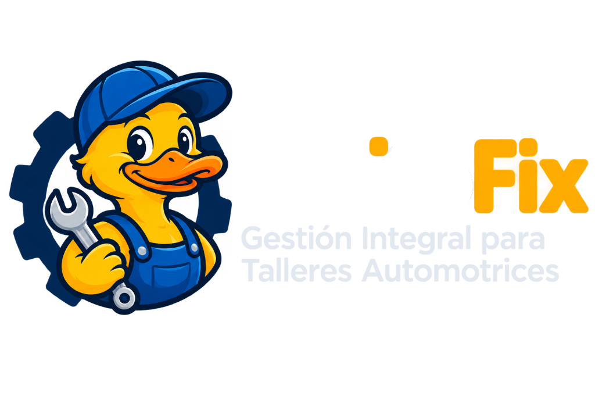

# PatitoFix Landing Page

## Descripción

Esta es la landing page **de alta conversión** para **PatitoFix**, un SaaS de gestión integral multi‑usuario para talleres mecánicos y centros automotrices. El diseño está inspirado en una estética futurista, minimalista y con elementos de antigravedad, neblina volumétrica y tipografía geométrica.

## Tecnologías usadas

- **HTML5, CSS3, JavaScript (ES6+)**
- **Tailwind CSS** (CDN) – utilidades de diseño rápido y glassmorphism.
- **GSAP + ScrollTrigger** – animaciones cinematográficas y efectos de scroll.
- **Three.js** – fondo interactivo 3‑D con esfera central y partículas.
- **Vanilla‑Tilt.js** – efectos de inclinación 3‑D en tarjetas y mockups.
- **Lenis** – desplazamiento vertical ultra fluido.
- **Lucide Icons** – iconografía minimalista.
- **Google Fonts** – `Space Grotesk` / `Outfit` para títulos y `Inter` para párrafos.

## Uso

1. **Navegación:** La barra de navegación flotante permite acceder a secciones como *Módulos*, *Precios* y *Flujo de Trabajo*.
2. **Hero interactivo:** El fondo 3‑D responde al movimiento del mouse y al desplazamiento.
3. **Demo del dashboard:** Desplázate para ver una vista previa del panel de control de PatitoFix.
4. **Tarjetas Bento Grid:** Cada tarjeta muestra una característica con efectos de iluminación al pasar el cursor.
5. **Planes de precios:** Cambia entre **mensual** y **anual** con el interruptor interactivo.

## Contacto

- **Autor:** Gabriel Isidro (PatitoFix)
- **Correo:** gabrielisidro8@gmail.com
- **GitHub:** [github.com/GabrielIsidro/PatitoFix-Page](https://github.com/GabrielIsidro/PatitoFix-Page)

---

*¡Explora la página y lleva tu taller a la próxima generación automotriz!*
